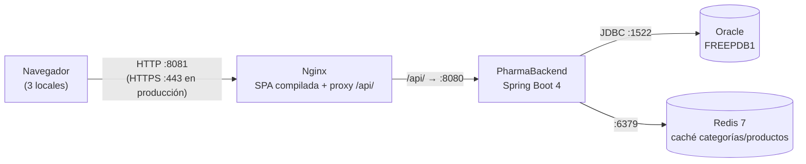

# PharmaBackend (sysventas)

API REST de PharmaSoft: Spring Boot 4, Java 21, Oracle, Redis y JWT.

## Desarrollo

```bash
docker run -d --name pharma-redis -p 6379:6379 redis:7-alpine
./mvnw spring-boot:run          # perfil dev (application-dev.yaml)
```

Swagger: `http://localhost:8080/swagger-ui.html` (solo en `dev`).

## Despliegue en producción

### Arquitectura



| Pieza | Puerto | Expuesto a los locales | Notas |
|---|---|---|---|
| Nginx (`web` en docker-compose) | 8081 → 80 | Sí (único punto de entrada) | Sirve `dist/pharma-frontend/browser` y reenvía `/api/` |
| PharmaBackend | 8080 | No (solo Nginx) | `/actuator/health` público; resto de Actuator exige `USUARIOS_ADMINISTRAR` |
| Oracle | 1522 | No | Fuente de verdad |
| Redis | 6379 | No | Caché con TTL de 10 min; si cae, el backend sigue respondiendo desde Oracle |

### Estado de las buenas prácticas de la sesión

| Buena práctica | Estado | Acción pendiente |
|---|---|---|
| Lazy Loading de cada feature (`loadChildren`/`loadComponent`) | Cumple | — |
| Code Splitting por página y `@defer` del reporte de más vendidos | Cumple | — |
| Presupuestos de tamaño (`budgets`) y `outputHashing: all` | Cumple | — |
| Caché del navegador: `immutable` 1 año para JS/CSS, `no-cache` para `index.html` | Cumple | — |
| Compresión | Cumple parcialmente | Solo gzip; evaluar Brotli |
| Caché Redis con TTL e invalidación en cada escritura y venta | Cumple | — |
| Degradación si Redis cae (`CacheErrorHandler`, `timeout: 500ms`) | Cumple | — |
| Logs con `requestId`, log de acceso y rotación (10 MB × 14) | Cumple | — |
| `requestId` en las respuestas de error y en los mensajes de la SPA | Cumple | — |
| Sin secretos ni DNI completos en el log | Cumple | Repetir la auditoría con `grep` tras cada versión |
| Secretos por variables de entorno en `prod` | Cumple parcialmente | `application-dev.yaml` versiona la clave de Oracle y del JWT de desarrollo: no reutilizarlas en producción |
| Health público, métricas protegidas | Cumple | — |
| HTTPS | No cumple | Certificado en Nginx (recomendación 1) |
| Copias de seguridad de Oracle | No cumple | Recomendación 2 |
| Backend en contenedor / servicio con reinicio automático | No cumple | Hoy se ejecuta con `java -jar` en la máquina anfitriona |
| Alertas sobre `/actuator/health` | No cumple | Recomendación 3 |

### Recomendaciones para los tres locales (en orden de prioridad)

1. **HTTPS en Nginx antes de abrirlo a los locales.** El token JWT viaja en cada petición; sin TLS cualquiera en la red del local puede leerlo. Certificado (Let's Encrypt o el de la empresa), redirección 80 → 443 y `Strict-Transport-Security`.
2. **Copias de seguridad diarias de Oracle y prueba de restauración.** Las migraciones de Flyway no se revierten: antes de cada despliegue, respaldo con Data Pump (`expdp`) y retención de al menos 7 días fuera del servidor.
3. **Un solo servidor central (Nginx + backend + un Redis compartido) con alertas sobre `/actuator/health`.** Un Redis por local daría stocks distintos entre locales; con uno solo, una venta invalida la caché para todos. Un monitor (Uptime Kuma o similar) consulta `/actuator/health` cada minuto y avisa si pasa a `DOWN`.


### Variables de entorno (perfil `prod`)

| Variable | Obligatoria | Propósito |
|---|---|---|
| `SPRING_PROFILES_ACTIVE` | Sí | `prod`: apaga Swagger y el SQL en el log, y escribe `logs/pharma-backend.log` |
| `DB_URL` | Sí | Cadena JDBC de Oracle, p. ej. `jdbc:oracle:thin:@//<host>:1522/<servicio>` |
| `DB_USERNAME` | Sí | Usuario de la base de datos |
| `DB_PASSWORD` | Sí | Contraseña de la base de datos |
| `JWT_SECRET` | Sí | Clave Base64 de al menos 256 bits para firmar los tokens. Generar una nueva: la de `dev` es pública |
| `JWT_EXPIRACION_MINUTOS` | No (30) | Vigencia del token |
| `FRONTEND_ORIGINS` | No (`http://localhost:8081`) | Orígenes permitidos por CORS |
| `REDIS_HOST` / `REDIS_PORT` | No (`localhost` / `6379`) | Ubicación de Redis |
| `SERVER_PORT` | No (8080) | Puerto HTTP del backend |

Los valores reales van en un archivo `.env` **fuera del repositorio** o en el gestor de secretos del servidor; nunca en un archivo versionado.

### Construir y desplegar

```bash
git checkout <tag-de-la-version>          # p. ej. v1.3.0
./mvnw clean package -DskipTests
cp target/sysventas-0.0.1-SNAPSHOT.jar /opt/pharma/releases/sysventas-v1.3.0.jar
# respaldo de Oracle ANTES de arrancar (Flyway aplica migraciones al iniciar)
expdp PHARMADB directory=BACKUP dumpfile=pharma_$(date +%F).dmp
ln -sfn /opt/pharma/releases/sysventas-v1.3.0.jar /opt/pharma/actual.jar
SPRING_PROFILES_ACTIVE=prod java -jar /opt/pharma/actual.jar
curl -s http://localhost:8080/actuator/health        # {"status":"UP"}
```

### Volver a la versión anterior

1. Detén el proceso actual.
2. Apunta `actual.jar` al jar anterior: `ln -sfn /opt/pharma/releases/sysventas-v1.2.0.jar /opt/pharma/actual.jar`.
3. Si la versión nueva aplicó una migración de Flyway, restaura el respaldo de Oracle tomado antes del despliegue (`impdp`): el jar anterior no reconoce el esquema nuevo.
4. Limpia la caché para no servir datos con el formato nuevo: `docker compose exec redis redis-cli FLUSHDB`.
5. Arranca y verifica `/actuator/health`.
